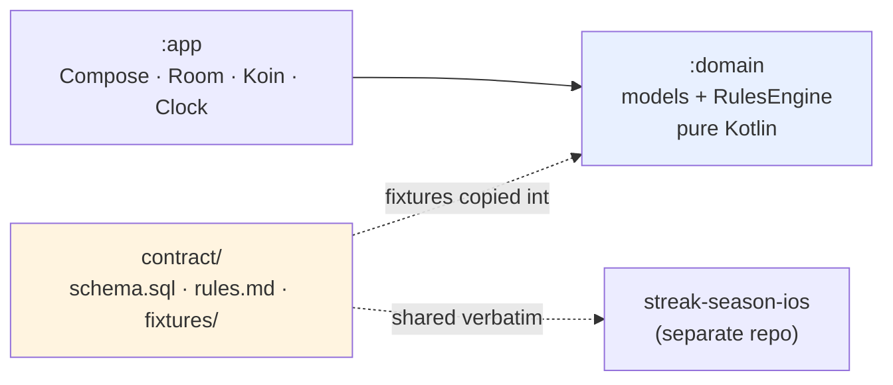
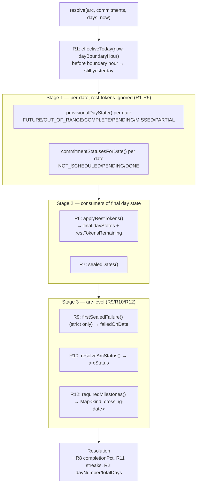
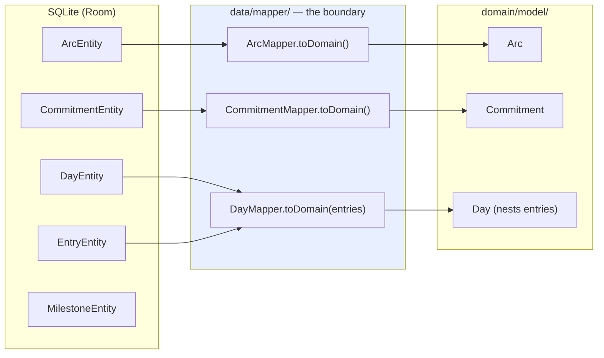
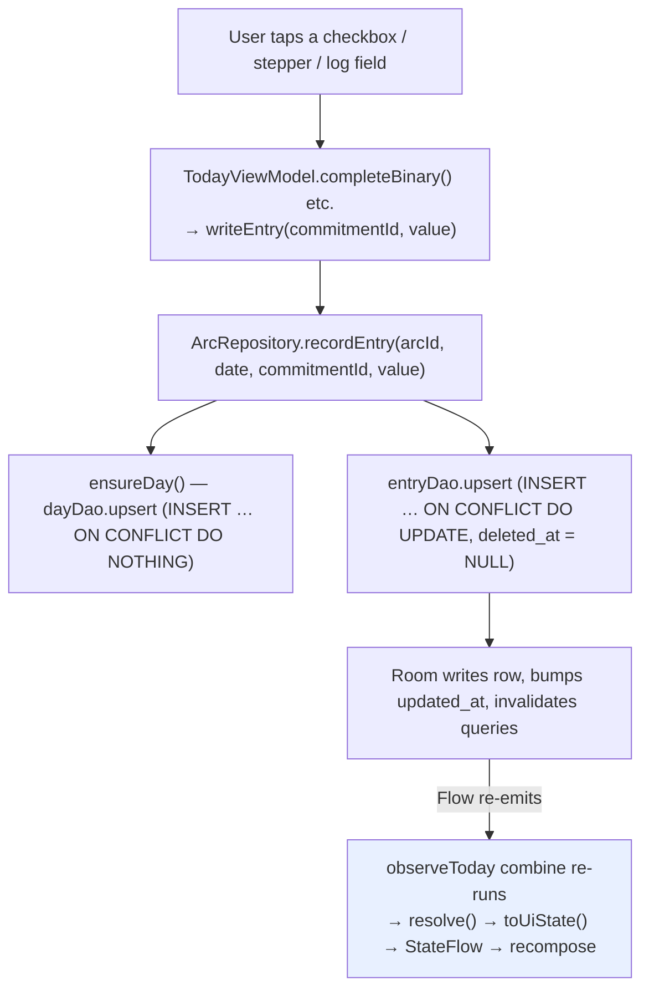

# Streak Season — Architecture

A walkthrough of how the Android app is built, written for whoever ports it to
Swift (probably me, in six months). It explains not just *what* the structure
is but *why* the odd-looking decisions are the way they are — the hand-written
upserts, the soft deletes, the engine that refuses to read the clock. Every
claim points at a real file and function so you can check it against the code
rather than trusting this doc, which will drift.

The domain noun is **arc**, not "streak" — the product is called Streak Season
but the code never is. `contract/rules.md` and `contract/schema.sql` are the
source of truth; this doc is a map, not an authority. Rules are numbered R1–R18.

---

## 1. The module split

Two Gradle modules, plus a plain folder that is not a module:

```
:app        Full Android — Compose, Room, Koin DI, the Clock. Depends on :domain.
:domain     Pure Kotlin (java-library + kotlin-jvm). No Android. ~10 files.
contract/   schema.sql, rules.md, fixtures/. Shared verbatim with the iOS repo.
```

Dependencies point **one way**: `:app` → `:domain`, never the reverse
(`app/build.gradle.kts` has `implementation(project(":domain"))`;
`domain/build.gradle.kts` has no Android anything). If something in `:domain`
reaches for `Context`, a coroutine, a Room type, or a repository interface, it
has leaked and belongs in `:app`.

### Why `:domain` has no Android dependency

Three reasons, in descending order of how much they'll bite you:

1. **It's the half that gets ported.** The whole point of the two-repo setup
   is that the rules engine is written twice — once in Kotlin, once in Swift —
   and kept in agreement by the shared fixtures (§8). A `:domain` that pulled
   in `android.*` couldn't be reasoned about as "the same logic as the Swift
   side," because half of it would be Android plumbing with no Swift analogue.
   Keeping it a plain JVM library means the Swift port is a translation of
   *business logic only*, function for function.

2. **It stays testable without an emulator.** `domain/src/test` runs on plain
   JUnit 5 (`useJUnitPlatform()` in `domain/build.gradle.kts`), no Robolectric,
   no device. The 62-fixture suite runs in under a second.

3. **It forces the derived-vs-stored line.** `:domain` *can't* persist
   anything — it has no database — so day state, streaks, rest-token
   consumption, completion percentage, arc status and milestone dates are all
   necessarily computed, never stored. That constraint is load-bearing (see
   §3 and the R14 note in §7).



---

## 2. Every file in `:domain`

`:domain` is deliberately tiny — CLAUDE.md says if it exceeds ~a dozen files,
something has leaked. Current inventory:

### `domain/model/` — the in-memory shapes the engine operates on

Each is a `data class` trimmed to only the fields the engine reads. Sync and
UI-only columns (timestamps, `metaphor`, `accent_color`, `icon`, row ids for
entries) live in the `:app` entities, not here.

| File | Holds | Notes |
|---|---|---|
| `model/Arc.kt` | id, name, start/end date, status, strictness, restTokensPerWeek, backfillDays, dayBoundaryHour | Dates are `LocalDate`, never timestamps. |
| `model/Commitment.kt` | id, name, type, targetValue, unit, isRequired, scheduleType, scheduleDays, activeFrom, activeUntil | `scheduleDays` stays the raw `"1,3,5"` string — parsing it is R3's job (the engine's), not the model's. |
| `model/Day.kt` | date, entries, restTokenUsed | A `Day` exists only if the user touched that date. **Absence is meaningful**: no `Day` = nothing logged, which R5 reads as `missed`/`pending`. |
| `model/Entry.kt` | commitmentId, value | `value`'s meaning depends on the commitment type (R4). No row id — that's persistence. |
| `model/Enums.kt` | `ArcStatus`, `Strictness`, `CommitmentType`, `ScheduleType`, `DayState`, `CommitmentStatus`, `MilestoneKind` | Plain enums, no serialized form on them — wire-string parsing lives in the test-side `WireEnums.kt` and the `:app` mappers. |

### `domain/rules/` — the logic

| File | Holds | Rules |
|---|---|---|
| `rules/RulesEngine.kt` | `RulesEngine.resolve()` + all its helpers + the `Resolution` data class | R1–R12 (see §3) |
| `rules/Validation.kt` | `earliestAllowedStartDate()`, `isValidStartDate()`, `isValidArcName()`, `hasAtLeastOneRequiredCommitment()` | R16–R18 |

`Validation.kt` is the one place in `:domain` with **public** (not `internal`)
functions besides `resolve()`. R16–R18 are creation-time validations, not
something `resolve()` computes, so `:app`'s create flow calls them directly
(`CreateArcUiState` in `CreateArcViewModel.kt` uses all four). R16's logic: an
arc can't start earlier than `today - backfillDays`, or it would be born with
sealed missed days already behind it (R7), which fails a strict arc instantly
(R9). No upper bound — a future start date is fine (`dayNumber` is just 0 until
it begins). R17 requires a non-blank name; R18 requires at least one required
commitment (an all-bonus arc computes 0% completion for its whole life under
R8, so it's blocked at creation rather than rendered).

### What is deliberately *not* in `:domain`

Repository interfaces, use-case classes, DI, coroutines, `Clock`. The engine
is a single synchronous pure function over in-memory lists. There is no
`RulesEngineImpl`, no interface — it's an `object` with one entry point.

---

## 3. The `resolve()` pipeline

`RulesEngine.resolve(arc, commitments, days, now)` is the whole engine. It
takes four in-memory values and returns one `Resolution`. `now` is a
`LocalDateTime` **parameter** — the engine never calls `LocalDate.now()`,
`System.currentTimeMillis()`, or reads a clock in any form (see the R14 note
below). It runs in three stages, each built on the last, because some
computations genuinely depend on earlier ones being finished first.



### Stage 0 — the date (R1)

`effectiveToday(now, arc.dayBoundaryHour)` — if the wall-clock hour is before
the arc's boundary hour, "today" is still yesterday. This is why a 1:30am
check-in lands on the previous date. Everything downstream keys off this
derived `today`, never off `now` directly.

Also computed up front: `dayNumber(arc, today)` and `totalDays(arc)` (R2).
`totalDays` is inclusive (`ChronoUnit.DAYS.between(start, end) + 1` — a
Jan 1→Jan 5 arc is 5 days). `dayNumber` is the size of `elapsedDates()`: 0
before the arc starts, pinned at `totalDays` once it's over.

### Stage 1 — per-date state, ignoring rest tokens (R1–R5)

A loop from `startDate` to `endDate` fills two maps:

- `provisionalDayState()` (R5) — each date's state *as if rest tokens didn't
  exist*: `FUTURE` (after today), `OUT_OF_RANGE` (outside the arc),
  `COMPLETE` (all required commitments satisfied, or none required),
  `PENDING` (today, not yet complete), else `MISSED`/`PARTIAL`.
- `commitmentStatusesForDate()` (R3/R4) — per commitment, per date:
  `NOT_SCHEDULED` / `PENDING` / `DONE`. Every commitment gets an entry for
  every date; there is no "missing key means not scheduled" shortcut (the
  `commit_status_no_missing_keys` fixture guards this).

R3 (`isScheduled`) and R4 (`isSatisfied`) are the leaf predicates here.
`isSatisfied` branches on `CommitmentType`: BINARY needs value ≥ 1, COUNTER/
DURATION need value ≥ target, LOG always counts.

### Stage 2 — rest tokens and sealing

`applyRestTokens()` (R6) is a **second pass**, not folded into stage 1, and
this ordering is the subtle part. Whether Thursday's rest token is valid
depends on how many tokens that same ISO week already spent — which depends on
stage 1 having already decided whether each earlier day would otherwise have
failed. So stage 1 must fully finish before stage 2 can walk the week in order
spending tokens. It converts some `PARTIAL`/`MISSED` days to `REST` and returns
the final `dayStates` plus `restTokensRemaining` per ISO week.

ISO week keys come from `isoWeekKey()`, built from
`IsoFields.WEEK_BASED_YEAR`/`WEEK_OF_WEEK_BASED_YEAR` — **not** `getYear()` and
**not** a locale-dependent `WeekFields`. The week-based year isn't always the
calendar year (2026-12-31 is week 1 of 2027), and a locale-dependent field
would disagree across devices and with the Swift port. **Swift port note:** use
`Calendar(identifier: .iso8601)`, not the current locale's calendar.

`sealedDates()` (R7) — dates more than `backfillDays` past are sealed (no longer
editable). The engine only *reports* which dates are sealed; enforcing that
sealed dates reject edits is `:app`'s job.

### Stage 3 — arc-level status and milestones

- `firstSealedFailure()` (R9) — strict arcs only. Walks `elapsedDates`
  ascending, `break`ing (not `continue`ing) at the first unsealed date, and
  returns the first sealed date that resolved `PARTIAL`/`MISSED`. The `break`
  matters: a miss that hasn't sealed yet is still fixable, so everything after
  it is unjudgeable until it seals.
- `resolveArcStatus()` (R10) — a strict failure always wins; otherwise an
  `active` arc past its end date becomes `completed`; otherwise status passes
  through unchanged. The engine only *derives* this — it does not mutate `arc`
  or write `completed_at`. That's reconciliation's job (§7).
- `requiredMilestones()` (R12) — returns `Map<MilestoneKind, LocalDate>`: every
  kind that should exist as of now, mapped to the **exact date its threshold
  was crossed**. `start` → startDate; `p25`/`p50`/`p75` →
  `startDate + (crossingDay - 1)` where `crossingDay = ceil(totalDays × n/d)`
  via integer `ceilDiv` (never `Double` — a float `>=` at a boundary lands on
  the wrong side); `final` → endDate (completed) or failedOnDate (failed).

  **This is the one rule the code already got wrong once.** R12 originally said
  `triggered_on_date` was "the today at which it was created," and the code
  briefly stamped `effectiveToday` on every crossed threshold. That conflates
  *when the app noticed* with *when the user crossed* — different for anyone who
  skips days. Task 12d amended R12 and restored the exact-crossing-date
  computation. If a future review pulls this back toward `effectiveToday`,
  re-read amended R12 first; the crossing date is exact arithmetic, not an
  estimate.

### The `Resolution` it returns

`effectiveToday`, `dayStates`, `currentStreak`/`bestStreak` (R11 —
walk-back-from-today and longest-run; a pending today is skipped, not counted),
`restTokensRemaining`, `completionPct` (R8 — fraction of *countable* elapsed
days that are complete, excluding rest/pending/future/no-required-scheduled),
`arcStatus`, `failedOnDate`, `sealedDates`, `dayNumber`, `totalDays`,
`commitmentStatuses`, `requiredMilestones`.

Everything in it is derived. Nothing here is stored anywhere — `:app` recomputes
it on every read (§5).

> **R13/R14/R15 note.** R13 (editing a live arc) and R14 (clock manipulation)
> are not engine functions. R14 is upheld *structurally* — the engine can't
> cheat the clock because it never reads one; `now` is always injected. R15
> (one active arc) is a persistence question answered in
> `ArcRepository.createArc()` via `hasActiveArc()`, not the engine.

---

## 4. The `:app` data layer: entity → mapper → domain

The boundary between "how it's stored" and "what the engine sees" is the
**mapper**. Three layers:



**Entities** (`data/entity/`) mirror `contract/schema.sql` exactly — every
column, including the sync scaffolding (`created_at`, `updated_at`,
`deleted_at`, `synced_at`) and Phase-2 columns not used yet (`metaphor`,
`accent_color`, `photo_path`). Types match SQLite storage: dates are `String`
(`"YYYY-MM-DD"`), booleans are `Int` (0/1), timestamps are `Long` epoch millis.

**Mappers** (`data/mapper/`) are `EntityType.toDomain()` extension functions.
They do the type conversions the domain wants: `LocalDate.parse(...)` for dates,
`== 1` for booleans, `valueOf(status.uppercase())` for enums (DB stores
lowercase `"active"`, the enum is `ACTIVE`).

`DayMapper.toDomain(entries)` is the odd one — it takes a parameter. The domain
`Day` nests its entries directly, but the schema splits days and entries into
separate tables, so this mapper needs the day's entries handed in. The
repository loads all entries, groups them by `day_id`, and passes each group in
(§5).

**Key boundary rule from CLAUDE.md:** dates are `LocalDate` in the domain,
`TEXT` in the DB, converted *at the mapper*. Never store or pass a calendar date
as a timestamp. The `_at` columns are true epoch-millis timestamps; the arc's
start/end/failed dates are calendar `TEXT`. Don't mix them.

---

## 5. The read path, end to end

Everything reactive flows from Room's `Flow`-returning DAO queries. When any
underlying row changes, Room re-emits, and the change propagates all the way to
the screen with no manual refresh.

```mermaid
flowchart TD
    dao["4 DAO Flows:<br/>arcDao.observeById · commitmentDao.observeByArc<br/>dayDao.observeByArc · entryDao.observeByArc"]
    dao -->|combine| snap["ArcRepository.observeSnapshot()<br/>→ ArcSnapshot(arc, commitments, days)"]
    snap -->|map through RulesEngine.resolve(now)| today["observeToday()<br/>→ TodaySnapshot(arc, commitments, todayEntries, resolution)"]
    pend["milestoneDao.observePendingByArc()<br/>→ observePendingMilestones()"]
    today -->|combine| vm["TodayViewModel<br/>toUiState() — pure mapping, no rules"]
    pend -->|combine| vm
    vm --> sf["StateFlow&lt;TodayUiState&gt;<br/>+ StateFlow&lt;PendingMilestoneUiState?&gt;"]
    sf -->|collectAsState| ui["TodayScreen when(state) { … }"]
```

Step by step:

1. **`ArcRepository.observeSnapshot(arcId)`** (`data/ArcRepository.kt`) does a
   `combine()` of four DAO Flows — the arc, its commitments, its days, its
   entries — mapping each entity to its domain model and grouping entries under
   their days. Output: `ArcSnapshot(arc, commitments, days)`. This four-DAO
   combine lives in exactly one place so both read methods share it.

2. **`observeToday(arcId)`** maps each snapshot through
   `RulesEngine.resolve(arc, commitments, days, clock.now())` and packages a
   `TodaySnapshot` — the `Resolution` plus the raw arc/commitments/today's
   entries the UI needs to render (the `Resolution` only carries derived state,
   not the per-commitment display data). `resolve()` is re-run on **every**
   underlying change; it's a cheap pure function over a few dozen rows, so
   there's no caching. (`observeResolution()` exists too — same map, returns the
   bare `Resolution` — used by `reconcile()` and the repository test.)

3. **`TodayViewModel`** (`ui/today/TodayViewModel.kt`) `combine()`s
   `observeToday` with `observePendingMilestones` into a single collector — one
   subscription, so `resolve()` doesn't run twice per DB change. Each emission
   sets `_state` (via `toUiState()`) and `_pendingMilestone`.

4. **`toUiState()`** is a **pure mapping** — no rule logic. It reads
   `arcStatus`/`failedOnDate` for the `Ended` case, `commitmentStatuses[today]`
   for the checklist, etc., straight off the `Resolution`. If you find yourself
   re-deriving a rule here, it belongs in the engine instead.

5. **`TodayScreen`** collects the `StateFlow`s with `collectAsState()` and
   `when`-branches over the sealed `TodayUiState` (`Loading` / `NoActiveArc` /
   `NotStarted` / `Ended` / `Loaded`). A non-null pending milestone takes over
   the whole screen ahead of any of those.

### The ViewModel-reuse wrinkle (no nav library)

This app has no `androidx.navigation` — `MainActivity` swaps composables with a
`when` over an in-memory `AppRoute` (§ below). That means `koinViewModel()`
returns the **same cached `TodayViewModel` for the whole process**, keyed by
class. Its `init` runs once. So `TodayViewModel.refresh()` is public and
re-callable, and `TodayRoute` drives it from a `DisposableEffect`: **entering**
the route calls `refresh()` (re-read the active arc, re-subscribe), **leaving**
calls `stopObserving()` (cancel the subscription). Without the cancel-on-exit,
a stale subscription to a now-deleted arc crashes when something else mutates
the DB while Today is off-screen (this actually happened with the debug menu's
DB wipe — the fix is why `stopObserving()` exists).

---

## 6. The write path, end to end

Writes are fire-and-forget into Room; the read path above carries the result
back automatically. Nothing manually pushes new state to the UI.



A tap calls a `TodayViewModel` method (`completeBinary`, `setCounterValue`,
`recordLog`, `undo`), which launches into `viewModelScope` and calls
`ArcRepository.recordEntry()` / `undoEntry()`. The write commits, Room
invalidates the affected queries, the `Flow`s in the read path re-emit, and the
screen recomposes. The ViewModel never sets state from the write side.

### Two decisions that look odd without context

**Hand-written upserts instead of Room's `@Upsert`.** See `EntryDao.upsert`,
`DayDao.upsert`, `MilestoneDao.upsert` — all raw `INSERT … ON CONFLICT(...) DO
UPDATE/NOTHING` SQL. Two reasons they can't be `@Upsert`:

- **`@Upsert` matches on the primary key**, which is a fresh random UUID every
  call — so it would never detect a conflict, always insert, and collide on the
  real unique index (`(day_id, commitment_id)` for entries, `(arc_id, kind)`
  for milestones, `(arc_id, date)` for days). The conflict target has to be the
  *actual* unique index, which only raw SQL can name.
- **It removes a check-then-act race.** The old code read "does this row
  exist?" then inserted or updated — two statements with a window between them
  where a concurrent writer could collide. `docs/tasks/10-fix-entry-write-race.md`
  replaced it with one atomic statement. `ensureDay()` then reads the row back,
  guaranteed to exist regardless of which concurrent insert won.

**Soft deletes, everywhere.** Nothing is ever hard-deleted — `undoEntry()` sets
`deleted_at`, it doesn't `DELETE`. Every read query filters `deleted_at IS
NULL`. This is for the (not-yet-built) sync engine: a hard delete is invisible
to sync, a soft delete is a syncable change. The catch this creates: a
soft-deleted row **still occupies its unique index**. So re-recording a
previously undone entry can't be a plain insert (it collides with the dead row)
— the upsert's `DO UPDATE SET … deleted_at = NULL` *revives* the dead row
instead. This has bitten the project more than once; the `MilestoneDao.upsert`
comment calls it out specifically.

**Every write bumps `updated_at`** (CLAUDE.md hard rule). The upserts set it via
`excluded.updated_at`; the `@Update` paths set it explicitly. No exceptions —
sync ordering depends on it.

---

## 7. Where `reconcile()` runs, and why not in `observeResolution`

The engine *derives* `arcStatus` and *which milestones should exist*, but it
can't write. Something in `:app` has to take a `Resolution` and make the stored
rows match it: flip `arcs.status` to `completed`/`failed`, set
`completed_at`/`failed_on_date`, and insert any milestone rows that should exist
but don't. That's `ArcRepository.reconcile(arcId)`.

It runs at **two explicit lifecycle moments**:

- `TodayViewModel.refresh()` — once, right after resolving the active arc id,
  before setting up the observe.
- `MainActivity.onResume()` — so an arc that ended while the app was closed
  reconciles the moment you come back.

```mermaid
flowchart TD
    subgraph why["Why NOT inside observeResolution()"]
        cold["observeResolution is a cold Flow.map — a READ path"]
        cold --> loop["a write bumps updated_at → Room invalidates →<br/>Flow re-emits → resolve again → write again → …"]
        loop --> storm["infinite write storm + re-runs on every collector/resubscribe"]
    end
    subgraph how["What reconcile() does instead"]
        call["explicit call: refresh() + onResume()"]
        call --> once["observeResolution(arcId).first() — ONE snapshot"]
        once --> stat["arcDao.updateStatusIfChanged() — WHERE guards on status differing"]
        once --> diff["diff requiredMilestones vs stored kinds → upsert only the missing"]
    end
    style storm fill:#ffe0e0
    style how fill:#e8f0ff
```

**Why not put it in `observeResolution` (the "obvious" place)?** Because that's
a cold `Flow.map` — a read path. A side effect that *writes* from inside it
would re-run on every collector and every resubscribe, and worse, create a
feedback loop: the write bumps `updated_at`, Room invalidates the query, the
Flow re-emits, `resolve()` runs again, and it writes again — forever. `reconcile`
is instead an imperative call at well-defined moments, reading a single snapshot
via `observeResolution(arcId).first()`.

**Idempotency** is guaranteed by construction, and there's a test for it
(`ArcRepositoryTest`, "reconcile is idempotent"):

- `ArcDao.updateStatusIfChanged` has `WHERE id = :arcId AND status != :status`
  — a second call with the same derived status writes zero rows, so
  `completed_at` is never re-stamped.
- Milestones are diffed: `reconcile` reads the stored kinds and upserts only
  the ones missing from the set, so a second pass inserts nothing new.

---

## 8. The fixture harness

The fixtures are the closest thing this project has to shared code between the
Kotlin and Swift apps. Each is a JSON file describing an arc, some check-ins, a
frozen `now`, and the expected `Resolution` fields. Both apps load the same
files and assert against them; when they disagree, a fixture goes red and tells
you which rule broke.

```mermaid
flowchart LR
    src["contract/fixtures/*.json<br/>(62 files, shared with iOS repo)"]
    src -->|":domain:copyFixtures Gradle task| gen["build/generated/fixturesResources/fixtures/"]
    gen -->|merged as test resources| cp["test classpath"]
    cp -->|FixtureLoader.loadAll| dto["List&lt;FixtureDto&gt;"]
    dto -->|"@TestFactory, one DynamicTest per file"| run["RulesEngineFixtureTest.runFixture()"]
    run -->|FixtureMapper.toDomain| eng["RulesEngine.resolve()"]
    eng -->|assert against ExpectDto| verdict["pass / fail per fixture"]
```

The chain:

1. **`contract/fixtures/*.json`** — the source of truth, checked into `contract/`
   and shared verbatim with the iOS repo. Format documented in
   `contract/fixtures/README.md`.

2. **`:domain:copyFixtures`** (in `domain/build.gradle.kts`) — a `Copy` task
   that copies the JSON into `build/generated/fixturesResources/fixtures/`,
   registered as a test `resources.srcDir` so it merges onto the test classpath
   the same way `src/test/resources` would. Copied into `build/`, never into
   `src/`. `processTestResources` and `test` both `dependsOn` it.

3. **`FixtureLoader.loadAll()`** (`domain/src/test/.../fixtures/FixtureLoader.kt`)
   — reads every `*.json` from the `fixtures/` classpath resource, `sortedBy`
   name for deterministic ordering, decodes each into a `FixtureDto` with
   `ignoreUnknownKeys = true`.

4. **`FixtureDto` / `ExpectDto`** (`Fixture.kt`, `Expect.kt`) — wire-shaped
   kotlinx.serialization DTOs matching the JSON exactly (`@SerialName` for
   snake_case). Every `expect` field is nullable: a fixture only asserts what
   it's about. Two fields have special assertion rules — `failed_on_date` is
   only meaningful alongside `arc_status` (asserted together), and
   `required_milestones` is asserted as a **whole map** (a kind the engine
   returns that the fixture omits is a failure — mirrors
   `commit_status_no_missing_keys`).

5. **`FixtureMapper.kt` + `WireEnums.kt`** — convert the DTOs to the domain
   `Arc`/`Commitment`/`Day` the engine takes, parsing dates and enum strings.

6. **`RulesEngineFixtureTest`** (`domain/src/test/.../rules/`) — a JUnit 5
   `@TestFactory` emitting one `DynamicTest` per fixture, named after the
   fixture id. Each runs `resolve()` on the mapped inputs and asserts each
   present `expect` field. `completion_pct` compares to 4 decimal places, round
   half up (both engines must round identically).

**Swift port note:** the Swift side loads these *same* JSON files and must
produce byte-identical results — same rounding, same ISO-week computation, same
integer milestone arithmetic. When the two disagree, the fixture is right and
whichever engine differs is wrong. Adding a rule means adding fixtures *first*,
then implementing until they pass, on both sides.

---

## Appendix — quick file map

```
domain/src/main/java/dev/priyanshu/arc/domain/
  model/{Arc,Commitment,Day,Entry,Enums}.kt   in-memory shapes
  rules/RulesEngine.kt                          resolve() + Resolution (R1–R12)
  rules/Validation.kt                           R16–R18 (creation-time)

domain/src/test/java/dev/priyanshu/arc/domain/
  fixtures/{Fixture,Expect,FixtureMapper,WireEnums,FixtureLoader}.kt
  fixtures/FixtureExpectKeysTest.kt             guards against typo'd expect keys
  rules/{RulesEngineFixtureTest,ValidationTest}.kt

app/src/main/java/dev/priyanshu/arc/
  data/AppDatabase.kt                           Room DB, 5 entities
  data/ArcRepository.kt                          the only stateful seam
  data/Clock.kt                                  the one wall-clock seam
  data/DebugSeeder.kt                            debug-only scenario seeding
  data/entity/*.kt                               schema.sql mirrors
  data/dao/*.kt                                  Flow reads + hand-written upserts
  data/mapper/*.kt                               entity → domain boundary
  di/AppModule.kt                                Koin modules
  ui/today/{TodayScreen,TodayViewModel,TodayUiState}.kt
  ui/create/{CreateArcScreen,CreateArcViewModel}.kt
  ui/debug/DebugMenuScreen.kt
  ui/nav/AppRoute.kt                             in-memory route switch (no nav lib)
  MainActivity.kt / StreakSeasonApp.kt

contract/
  schema.sql · rules.md · fixtures/*.json + README.md
```
